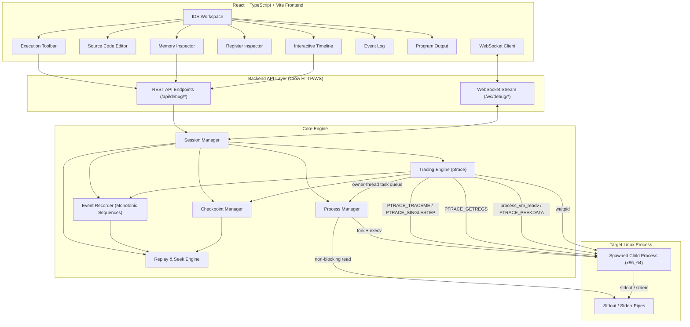

# Architecture — Web-Based Linux Process Time-Travel Debugger

## 1. System Overview

The **Web-Based Linux Process Time-Travel Debugger** is a full-stack, systems-level debugging tool designed for Linux x86_64 environments. It combines kernel-level process supervision (`ptrace`) with an interactive, web-based developer workspace, enabling live instruction stepping, structured execution recording, immutable state checkpoints, and non-destructive historical timeline inspection.

---

## 2. Component Breakdown

### A. Process Manager (`backend/src/process/`)
- **Compilation:** Uses POSIX `fork()` and `execv()` to invoke `/usr/bin/gcc` or `/usr/bin/g++` directly with explicit arguments (`-g`, `-O0`, `-Wall`, `-Wextra`, `-no-pie`), completely avoiding shell string concatenation or `system()`.
- **Diagnostics Capture:** Captures compiler stdout and stderr through non-blocking pipes (`pipe2(..., O_CLOEXEC)`), surfacing compiler diagnostics with accurate error codes.
- **Child Supervision:** Spawns target processes in child forks with `PTRACE_TRACEME` and standard I/O redirection before `execv`. The parent captures a pidfd for race-safe Pause and Stop signals.
- **Resource Reaping:** The session tracing owner consumes final wait statuses and synchronously reaps the child before closing its pipes and pidfd.

### B. Linux Tracing Engine (`backend/src/tracing/`)
- **Kernel Interface:** Directly interfaces with Linux `ptrace` system call.
- **Tracing Options:** Configures `PTRACE_O_EXITKILL`. It deliberately omits `PTRACE_O_TRACEEXIT`; final `waitpid` statuses are consumed directly.
- **Register Access:** Extracts x86_64 `user_regs_struct` via `PTRACE_GETREGS` after each recorded instruction and at pause points (RIP, RSP, RBP, RAX..R15, EFLAGS).
- **Safe Memory Inspection:** Inspects process virtual memory via `process_vm_readv` (with fallback to `PTRACE_PEEKDATA`). Enforces strict address validation, null-pointer rejection, and a hard 1024-byte per-read safety limit.
- **Instruction Stepping:** Employs hardware trap single-stepping via `PTRACE_SINGLESTEP`.
- **Owner Thread:** A persistent per-session executor thread performs the fork, initial wait, every ptrace call, and every tracee `waitpid`. Requests from HTTP and Resume workers are serialized through its command queue. Operations reject a caller TID mismatch.

### C. Event Recorder (`backend/src/recording/`)
- **Ordered History:** Maintains an append-only, thread-safe sequence of execution events.
- **Strict Monotonicity:** Every event receives a strictly monotonic sequence identifier (`1, 2, 3...`).
- **Telemetry Metadata:** Stores timestamp, PID, RIP, register snapshot (when captured), signals, and associated checkpoint IDs.
- **Bounded Storage:** Configured with a default ring buffer capacity of 10,000 events to prevent memory exhaustion.

### D. Checkpoint Manager (`backend/src/checkpoint/`)
- **State Capture:** Captures immutable checkpoints at execution boundaries, initial stops, and periodic step intervals.
- **Coverage Description:** Stores general-purpose registers, stack slice (`[RSP - 16, RSP + 64]`), and an explicit metadata notice detailing what state is preserved and what is omitted (e.g. kernel file descriptors, uncaptured heap).

### E. Replay & Historical Navigation Engine (`backend/src/replay/`)
- **Seek Orchestration:** Validates target sequence range `[1, latest]`.
- **Truthful Availability:** Distinguishes `exact_snapshot`, `interpolated_checkpoint`, and `event_metadata_only`.
- **Register Differencing:** Computes exact delta differences between consecutive events, highlighting changed registers.
- **Honest Limitations:** Emits a clear advisory notice that historical viewing inspects saved records without altering live process state.

### F. Session Manager (`backend/src/session/`)
- **Lifecycle Coordination:** Enforces a thread-safe state machine:
  `CREATED → COMPILING → STARTING → RUNNING ↔ PAUSED → EXITED / STOPPED / FAILED`.
- **Concurrency Control:** Prevents conflicting control requests using internal mutex locks; all tracee operations are dispatched to the persistent owner thread.
- **Resume Recording:** Resume repeatedly uses `PTRACE_SINGLESTEP`, recording a real stopped state for each executed instruction, until Pause, Stop, exit, or the configured event limit.
- **Broadcast Callbacks:** Notifies listeners of real-time events for WebSocket streaming.

### G. API Layer (`backend/src/api/`)
- Built using Crow C++20 microframework with Asio networking.
- REST API on port 8080 exposing health, capabilities, lifecycle controls, timeline queries, and memory inspection.
- WebSocket streaming at `/ws/debug/{sessionId}` with auto-subscription and ping/pong keepalives.

### H. Frontend IDE (`frontend/src/`)
- React 18 + TypeScript + Vite desktop-first IDE.
- Monaco-style code editor with compilation error banners.
- Interactive scrubbable execution timeline with checkpoint markers.
- Register inspector with hex/decimal views and delta highlights.
- Memory hex dump viewer with ASCII translation and register shortcuts (`$rsp`, `$rip`).
- Filterable event log table and separate standard output/error console.

