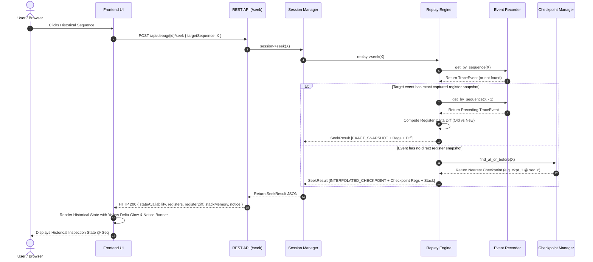

# Execution Flow — Web-Based Linux Process Time-Travel Debugger

## 1. Complete Session Lifecycle

```text
[User Code Input] 
       │
       ▼
1. Compilation (fork + execv gcc/g++)
       │
       ├── Failure ──> Return Compiler Diagnostics & State = FAILED
       │
       ▼ (Success)
2. Session Owner Thread forks child (PTRACE_TRACEME + execv)
       │
       ▼
3. Same Owner Thread Intercepts Initial Trap (SIGTRAP on execv)
       │
       ▼
4. Initialize ptrace (PTRACE_SETOPTIONS: EXITKILL)
       │
       ▼
5. Capture Initial Telemetry (PTRACE_GETREGS, Stack Slice, Checkpoint #1)
       │
       ▼
6. State = PAUSED (Ready for Stepping / Execution)
       │
  ┌────┴─────────────────────────────┐
  ▼                                  ▼
[Step Instruction]             [Resume Recorded Run]
  │                                  │
  ▼                                  ▼
Owner Queue: PTRACE_SINGLESTEP Owner Queue: repeated PTRACE_SINGLESTEP
  │                                  │
  ▼                                  ▼
Record Registers + Event       Record each instruction until stop / exit
  │                                  │
  └───────────────┬──────────────────┘
                  │
                  ▼
7. Process Exit (WIFEXITED / WIFSIGNALED)
       │
       ▼
8. Final Telemetry Recorded & State = EXITED
       │
       ▼
9. Time-Travel History Remains Fully Inspectable
```

The persistent owner thread creates and initially waits for the tracee, then remains alive for the whole active session. HTTP handlers and the Resume loop submit serialized operations to that thread; no other thread calls `ptrace` or waits for the tracee. Pause and Stop use the session pidfd to signal the exact child and let the owner collect the resulting wait status.

---

## 2. Historical Seek Sequence

When the user selects an earlier historical position or scrubs the execution timeline, the system processes the request as shown in the sequence diagram below:



